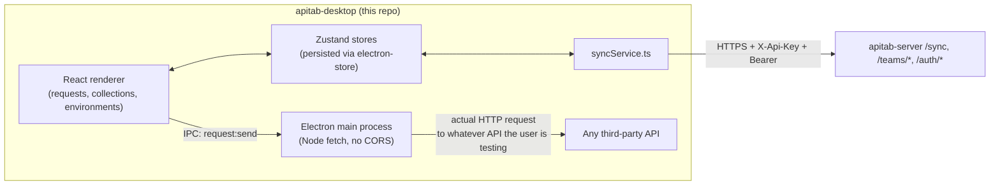
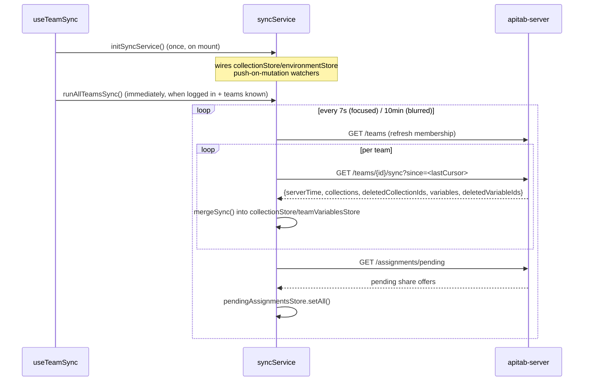
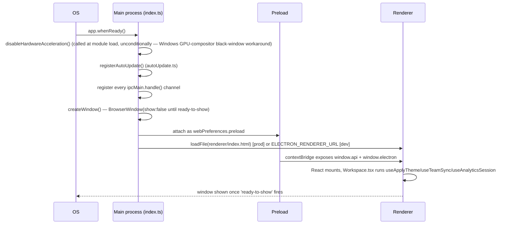

# ApiTab Desktop — SKILL.md

> This file is the permanent architectural knowledge base for **apitab-desktop**. It is written so that any AI coding assistant (or human) can understand the entire ApiTab ecosystem and this repository's role in it without exploring the code first, and can then confidently add features, fix bugs, and refactor without breaking cross-repo contracts.

---

## Part 0 — The ApiTab Ecosystem

### What ApiTab is

ApiTab is a lightweight, local-first API testing tool — "a fast, minimal alternative to Postman." A user builds and sends HTTP requests, organizes them into collections/folders, manages environments of `{{variables}}`, writes pre-request/post-response test scripts, and — optionally, if they create an account — shares collections with a team and keeps them in sync across devices.

### Why three repositories

| Repo | Role | Runtime |
|---|---|---|
| **apitab-server** | Backend/API. Owns accounts, teams, sharing permissions, and the sync protocol. Also serves the public marketing/download landing page. | Laravel 12 / PHP 8.2, self-hosted |
| **apitab-desktop** (this repo) | Electron desktop client. Full request-builder UI, runs requests from the Electron **main process** (no CORS restrictions). | Electron 43 + React 19 + Zustand |
| **apitab-extension** (repo name `ApiTab`, package name `apitab`) | Browser extension client (Chrome MV3 / Firefox MV2). Same request-builder UI, runs requests from the **background service worker**. | WXT + React 19 + Zustand |

This repo and the extension are **siblings that share almost the entire application layer** — the same Zustand store shapes, the same `@/*` import alias (explicitly chosen in `electron.vite.config.ts` to match the extension's own alias, so ported UI code drops in with unchanged import paths), the same feature-folder structure, the same script-sandbox design (`new Function('apitab','pm','console', code)` run inside an isolated iframe), and a `syncService.ts` that is close to byte-identical between the two. **This is the single most load-bearing architectural fact about this repo**: when porting a fix or feature between the two clients, the file layout and import paths are expected to match closely enough that a diff often applies almost unchanged.

Where the two clients differ, it's because the platform forces it:

| Concern | apitab-desktop (this repo) | apitab-extension |
|---|---|---|
| Executing an HTTP request | Node `fetch` in the Electron **main process**, reached via `window.api.request.send()` → `ipcRenderer.invoke('request:send')` | `fetch` in the **background service worker**, reached via `browser.runtime.sendMessage` |
| Local storage backing | `electron-store` (a JSON file under the OS user-data dir), wrapped behind an async `browser.storage.local`-shaped IPC API | `browser.storage.local` directly |
| How many JS contexts exist at once | **One** — a single `BrowserWindow` renderer. No cross-context sync problem. | **Several, simultaneously** — background worker + any number of open app/popup/options pages, each with its own in-memory Zustand copy, reconciled only through `browser.storage.local` + a `browser.storage.onChanged` listener |
| Update mechanism | Self-managed via `electron-updater` (GitHub Releases feed) | Browser's own extension store auto-update — no in-app update UI at all |
| Permission model | Electron process isolation: `contextIsolation:true`, `nodeIntegration:false`, a typed `contextBridge` preload surface | Manifest-declared permissions (`host_permissions`, `storage`, `alarms`) enforced by the browser |
| Platform/version lookup | Real async IPC round-trip (`window.api.app.getPlatform/getVersion`) | Synchronous browser APIs, wrapped in `async` only to keep a matching call signature with desktop |

This backend-independent app-layer sharing means **this SKILL.md should be read alongside `apitab-extension`'s own SKILL.md** whenever you're porting a change between the two — the extension's file is the other half of this picture.

### Responsibility split

- **apitab-server**: authentication, team membership/roles, per-user collection-assignment (sharing) state machine, the polling `/sync` endpoint, team-shared variables, usage analytics, the landing page.
- **apitab-desktop / apitab-extension**: everything about actually building, sending, and inspecting HTTP requests; all UI; local-first storage (a signed-out user's data never touches the server at all); the sync *engine* that talks to the server's `/sync` endpoint on a timer.

### How this repo communicates with the server

Every request to `apitab-server` from this app carries two headers, set in `src/renderer/src/config/server.ts`:

- `X-Api-Key: <API_KEY>` — a static, build-time key that must equal the server's `APP_API_KEY`. Checked before anything else. Not a secret in any real sense (it's in the shipped bundle) — it's a coarse "legitimate client build" gate, not authentication.
- `Authorization: Bearer <token>` — present once a user logs in (via `apiClient.ts`, reading the token from `accountStore`), absent for anonymous/local-only usage.

`API_BASE_URL = 'https://apitab.bitflw.com/api'` and `API_KEY` are hardcoded constants — self-hosters must change both here (and in the extension's matching `config/server.ts`, and the server's `.env`) to point at their own deployment.

### Data flow



Two entirely separate kinds of HTTP traffic happen from this app: (1) the user's own API-under-test requests, always executed in the **main process** for CORS-free access, and (2) this app's own sync traffic to `apitab-server`, which runs from the **renderer** via plain `fetch` in `apiClient.ts` (sync traffic doesn't need the CORS bypass since `apitab-server` sets `Access-Control-Allow-Origin: *`).

### Authentication flow (as seen from this repo)

1. `LoginDialog.tsx` calls `apiClient.login`/`register` → server returns `{token, user}`.
2. `accountStore.setSession({token, user})` — persisted to `electron-store` under key `apitab:account`.
3. Every subsequent `apiClient.ts` call attaches the bearer token automatically.
4. If `user.emailVerified === false`, `syncService.ts`'s `runAllTeamsSync()` refuses to poll and instead opens the login/verify dialog — this app never silently retries against an endpoint it knows will 403.
5. **A known, previously-real bug class**: `LoginDialog.tsx`'s `afterAuthenticated()` calls `runAllTeamsSync({skipRehydrate: true})` immediately after setting the fresh session in memory. The `skipRehydrate` flag is **required** here — omitting it makes `runAllTeamsSync` re-read the account/team stores from disk before trusting them (normally correct, for a cold-started service-worker-equivalent case), which races the just-written session's own unawaited persist-to-disk call. If the disk read wins the race — very plausible right after a **logout→login** cycle, where a prior `session: null` write is still the most recent thing on disk — the fresh in-memory session gets silently clobbered back to `null`, and the sync pass aborts with **no error and an empty workspace**. This shipped, was diagnosed with a from-scratch zustand-persist reproduction (proving it 5/5 without the flag, 0/5 with it), and fixed. **Never remove `skipRehydrate: true` from this call site.**

### Synchronization flow

Both clients poll — the server never pushes. `useTeamSync.ts` in this repo:



A collection is visible to this app's user **only if the server considers their assignment `accepted`** — see the server's own SKILL.md Part 9/10 for the full protocol. This app's job is simply: push local team-tagged edits when they happen, pull whatever the server says changed, merge, never invent conflict-resolution logic client-side (409 → adopt the server's copy, no merge UI, ever).

**A second known, previously-real bug class, specific to the push side**: `onCollectionsChanged` (the `collectionStore` subscriber in `syncService.ts`) treats *any* team-tagged collection disappearing from local state as "the user deleted it," and for an owner/admin, pushes a real `DELETE` to the server. Logging out clears local team-collection state (`clearTeamCollectionsOnLogout` in `AccountMenu.tsx`/`OptionsPage.tsx`) — if that clear isn't wrapped in the `applyingRemote` suppression flag first, the watcher fires for real, and a plain logout silently soft-deletes every team collection the logged-out user owned or administered on the server. This shipped, was traced to the exact watcher, and fixed by routing the logout-time clear through `clearTeamCollectionsOnLogout()` in `syncService.ts`, which sets `applyingRemote = true` before calling `collectionStore.clearTeamCollections()`. **Never call `useCollectionStore.getState().clearTeamCollections()` directly from a logout handler — always go through `syncService.ts`'s wrapper.**

### Shared concepts / terminology

See the server's SKILL.md Part 0 for the full glossary (Collection, Environment, Team/Workspace, Assignment, Shared variable, `since` cursor) — identical meanings here. This repo additionally uses:

| Term | Meaning in this repo |
|---|---|
| **Draft** | The single in-progress request being edited, held in `requestStore` (persisted key `apitab:draft`) — not the same as a *saved* request inside a collection. |
| **Personal workspace** | The UI's name for "no team selected" (`activeTeamId === null`) — collections with no `teamId` live here, purely local, never synced. |
| **Sandbox** | The isolated iframe (`sandbox.html`) where pre-request/post-response scripts actually execute — see Part 14. |
| **Main process / renderer / preload** | Standard Electron three-way split — see Part 4. |

### Shared design philosophy

Local-first, sync-optional; server is the sole authority on timestamps and conflicts; assignment-based (not blanket team-membership) sharing; soft-delete + id-reuse as a first-class flow. This repo's job is to be a faithful, correctly-timed client of that model — see the two bug classes documented above for what "faithful" has actually meant in practice (both were subtle timing/ordering bugs, not logic errors).

### Version compatibility

No explicit versioning. `SyncResponse`/`Collection`/`TeamVariable`/etc. TypeScript interfaces in `src/renderer/src/types/` are hand-kept in sync with the server's `toWire()` shapes — there is no compile-time or runtime contract check across repos. When the server's response shape changes, this repo's matching type must be updated in the same logical change.

### Deployment relationship

This repo tags releases (`v*`) → `.github/workflows/build.yml` builds Windows/macOS/Linux installers in a 3-OS CI matrix → publishes them as GitHub Release assets (too large for git) → `apitab-server`'s landing page (`welcome.blade.php`) links directly to those asset URLs, **hardcoded, not automated** — after every tagged release here, someone must manually update the server's landing page with the new version string, filenames, and sizes. See the server's SKILL.md Part 17 for the exact fields.

---

## Part 1 — Project Overview

**Purpose**: a native, no-browser-required API testing client with feature parity to the browser extension, distinguished mainly by having no CORS restrictions on outbound requests (since they run in the Electron main process, not a browser sandbox).

**Goals**: byte-for-byte-as-possible parity with the extension's application layer, so fixes and features port with minimal translation; a genuinely native desktop experience (real window, real OS notifications-equivalent via toasts, real auto-update).

**Target users**: developers testing APIs — especially ones hitting CORS-restricted endpoints where the browser extension's `<all_urls>` host-permission bypass isn't available or convenient, or who simply prefer a standalone app.

**Main features**: full request builder (params/headers/auth/body/scripts), collections + folders, environments with `{{variable}}` interpolation and autocomplete, pre-request/post-response test scripting (Postman-`pm`-API-compatible, sandboxed), response viewer (pretty/raw/table for JSON, preview/raw for HTML, headers, generated cURL/code snippets, test results), history, team collaboration (share/manage-access/accept/decline, team-shared variables), self-update, JSON backup/restore.

**Core philosophy**: local-first; the app is fully useful with zero account, zero network (beyond whatever API the user is actually testing).

**Architecture overview**: standard three-process Electron split (main/preload/renderer) built with `electron-vite`; renderer is a single-page React app (no router — page composition happens directly in `App.tsx`) backed by ~13 Zustand stores, most persisted through a `browser.storage.local`-shaped IPC bridge onto `electron-store`.

---

## Part 2 — Technology Stack

| Technology | Version | Why |
|---|---|---|
| Electron | ^43.0.0 | Native window + Node access for CORS-free requests and real filesystem-backed storage. |
| electron-vite | ^5.0.0 | Vite-based build tooling purpose-built for Electron's three-target (main/preload/renderer) build — replaces a hand-rolled webpack setup. |
| React | ^19.2.7 | UI library, matches the extension's version exactly (shared component code). |
| Zustand | ^5.0.14 | Minimal state management, matches the extension exactly (shared store code). |
| Tailwind CSS | ^4.3.1 (via `@tailwindcss/vite`) | Styling, matches the extension exactly (shared component styling). |
| electron-updater | ^6.8.9 | Self-update against a GitHub Releases feed. |
| electron-store | ^11.0.2 | Simple JSON-file storage in the main process, wrapped to present a `browser.storage.local`-shaped interface so the extension's persist adapters port over almost unchanged. |
| electron-builder | ^26.15.3 (dev) | Packages installers for Windows (NSIS)/macOS (DMG)/Linux (AppImage, tar.gz, deb, rpm). |
| TypeScript | ^6.0.3 | Type safety across all three build targets, sharing types via `src/shared/types.ts`. |
| uuid | ^14.0.1 | Client-side id generation — these ids are reused as-is on the server for team-shared entities. |
| lucide-react | ^1.21.0 | Icon set, matches the extension exactly. |

**electron-vite's three-target build** (`electron.vite.config.ts`): one `defineConfig` call defines three independent Vite configs:
- **`main`** — Node target, `src/main/*` → `out/main`. Uses `externalizeDepsPlugin()` so Node-only deps aren't bundled, **except `electron-store`, which is deliberately excluded from externalization** — it ships ESM-only with no CommonJS export condition, so bundling (letting Rollup unwrap its default export at build time) is required instead of externalizing it.
- **`preload`** — `src/preload/*` → `out/preload`.
- **`renderer`** — root `src/renderer`, → `out/renderer`. Has **two HTML entrypoints**: `index.html` (main app window) and `sandbox.html` (the sandboxed script-execution iframe target) — both must be explicitly listed in `rollupOptions.input`, since Vite otherwise only picks up the root `index.html`.

---

## Part 3 — Folder Structure

```
src/
├── main/                       # Electron main process (Node) — owns window, IPC handlers, real HTTP execution, storage
│   ├── index.ts                #   app bootstrap, window creation, IPC channel registration
│   ├── autoUpdate.ts           #   electron-updater wrapper + AppImage-Linux special-casing
│   ├── requestHandler.ts       #   executeRequest() — the actual Node fetch for user-tested APIs
│   └── store.ts                #   electron-store wrapped as an async browser.storage.local-shaped API
├── preload/
│   ├── index.ts                #   contextBridge.exposeInMainWorld('api', ...) — the ONLY renderer↔main surface
│   └── index.d.ts              #   global Window typing (window.api, window.electron)
├── shared/
│   └── types.ts                #   wire-format contract shared by all three targets (@shared/* alias)
└── renderer/
    ├── index.html               # main window entry
    ├── sandbox.html              # sandboxed script iframe entry
    └── src/
        ├── App.tsx, main.tsx     # renders <Workspace/> directly, no router
        ├── sandbox-main.ts        # the sandbox iframe's own entry script
        ├── config/                # server.ts (API_BASE_URL/API_KEY), about.ts
        ├── components/            # shared/reusable UI + ui/ subfolder of primitives
        ├── features/              # feature-scoped panels/dialogs, grouped by domain (account/collections/environments/history/layout/requests)
        ├── hooks/
        ├── pages/                 # OptionsPage.tsx (real), WorkspacePage.tsx (vestigial, see below)
        ├── services/
        ├── stores/                # Zustand stores + persist.ts adapter
        ├── types/                 # data model definitions, barrel index.ts
        └── utils/
```

Root also has: `electron-builder.yml`, `electron.vite.config.ts`, `tsconfig.json` (root, references-only) + `tsconfig.node.json` (main/preload/shared) + `tsconfig.web.json` (renderer), `.github/workflows/build.yml`, `build/` (electron-builder resources: entitlements, icons), `resources/icon.png`.

**Ownership rules**: `src/main/` is the only place Node/Electron privileged APIs are touched. `src/renderer/` must never import Node built-ins directly — everything privileged goes through `window.api` (typed via `src/shared/types.ts` + `src/preload/index.d.ts`). `src/preload/` is intentionally thin — it should only ever be a 1:1 `ipcRenderer.invoke` mapping, never business logic.

**What should never belong in `src/renderer/`**: direct `fs`/`net`/Node-API usage — if the renderer needs something privileged, add an IPC channel in `main/index.ts` + expose it in `preload/index.ts`, don't reach around the bridge.

**Note on `pages/WorkspacePage.tsx`**: this file is a trivial `export function WorkspacePage() { return <Workspace />; }` wrapper, but `App.tsx` actually renders `<Workspace />` directly, not `<WorkspacePage />` — this file appears vestigial/unused in current routing. Don't be surprised it exists; don't assume it's wired into anything without checking `App.tsx` first.

---

## Part 4 — Architecture

### Process split & startup lifecycle



`setWindowOpenHandler` denies any new native Electron window and instead calls `shell.openExternal` for clicked links — this app is deliberately single-window.

### IPC channel inventory (main ⇄ renderer, the entire privileged surface)

| Channel | Registered in | Handler | Purpose |
|---|---|---|---|
| `request:send` | `main/index.ts` | `executeRequest(req)` (`requestHandler.ts`) | Runs a user's API-under-test request in the main process — no CORS. |
| `storage:get` | `main/index.ts` | `storageGet(keys)` (`store.ts`) | Reads from `electron-store`. |
| `storage:set` | `main/index.ts` | `storageSet(items)` | Writes key/value pairs. |
| `storage:remove` | `main/index.ts` | `storageRemove(keys)` | Deletes keys. |
| `storage:clear` | `main/index.ts` | `storageClear()` | Wipes the whole store. |
| `app:getVersion` | `main/index.ts` | `app.getVersion()` | Desktop equivalent of the extension's `browser.runtime.getManifest().version`. |
| `app:getPlatform` | `main/index.ts` | `process.platform` | Renderer has no direct Node access. |
| `update:getStatus` | `autoUpdate.ts`'s `registerAutoUpdate()` | returns current `UpdateStatus` | Polled once on mount by `useAutoUpdate`. |
| `update:check` | same | `autoUpdater.checkForUpdates()` | Manual/passive check trigger. |
| `update:download` | same | `autoUpdater.downloadUpdate()` | User-gated (never auto-downloads). |
| `update:install` | same | `autoUpdater.quitAndInstall()` | User-gated (never auto-installs). |
| `update:status` (push, not invoke) | `autoUpdate.ts` broadcasts via `webContents.send` | — | Fires on every `autoUpdater` event; `preload`'s `update.onStatus(cb)` subscribes and returns an unsubscribe function. |

Every one of these is `satisfies`-typed against an interface in `src/shared/types.ts` (`StorageApi`, `AppApi`, `UpdateApi`), so the preload's exposed object literal is guaranteed to match the shared contract exactly — if you add a channel, add it to the matching shared interface first, then implement it in both `main/index.ts` and `preload/index.ts`.

### The AppImage/Linux auto-update special case

`electron-updater`'s Linux updater only functions from a genuine `.AppImage` launch — it needs the `APPIMAGE` env var, which only a real AppImage runtime sets. This repo also publishes `.tar.gz`/`.deb`/`.rpm` builds with no such runtime. `autoUpdate.ts` computes `isUnsupportedLinuxBuild = process.platform === 'linux' && !process.env.APPIMAGE` and, when true (or when `!app.isPackaged`, i.e. dev), registers **no-op** IPC handlers reporting `{state: 'unsupported'}` instead of wiring the real `electron-updater` flow — this avoids a noisy "APPIMAGE env is not defined" console warning on every startup for anyone running the tar.gz/deb/rpm build. **This is intentionally a UI/UX fix, not a functional regression**: deb/rpm users get real OS-level updates through their package manager instead; only the tar.gz manual-extract path has no update mechanism at all, which is expected and acceptable for that format.

---

## Part 5 — Core Modules

### `src/main/index.ts`

Window/app bootstrap and every `ipcMain.handle` registration (Part 4's table). No app-menu customization file exists — `autoHideMenuBar: true` on the `BrowserWindow` is the only menu handling.

### `src/main/requestHandler.ts`

`executeRequest(req: PreparedRequest): Promise<RequestResult>` — validates the URL starts with `http(s)://`, builds a Node `Headers` object from `req.headers` (a `[string,string][]` tuple array, not a plain object, so duplicate header names survive), builds `FormData` for `bodyType: 'form-data'` (deleting any manually-set `content-type` first so `fetch` sets the multipart boundary itself), uses `AbortController` + `setTimeout(req.timeoutMs)` for cancellation, `performance.now()` for timing. Classifies errors via `classifyError`: `AbortError` → `timeout`, `TypeError` → `network` (e.g. DNS failure), else `unknown`. This is the exact desktop analogue of the extension's `httpClient.ts` (which does the identical job inside a background service worker instead of a main process).

### `src/main/store.ts`

Wraps `electron-store` (`new Store({name: 'apitab-workspace'})`, lazily constructed since `app.getPath('userData')` isn't ready until `app.whenReady()`) behind an async interface shaped exactly like `browser.storage.local`: `storageGet/Set/Remove/Clear`. This is what lets `persist.ts` (renderer) be a near-verbatim port of the extension's storage adapter.

### `src/main/autoUpdate.ts`

Wraps `electron-updater`'s singleton `autoUpdater` (`autoDownload=false`, `autoInstallOnAppQuit=false` — every download/install step is user-gated, never automatic). Tracks module-level `status: UpdateStatus`, broadcasts on every event to every open `BrowserWindow`. Fires one passive `checkForUpdates()` 3 seconds after registration. See Part 4 for the AppImage special case.

### Renderer services (`src/renderer/src/services/`)

| Service | Purpose |
|---|---|
| `apiClient.ts` | Thin fetch wrapper against `apitab-server`. Every method maps 1:1 to a server route — see Part 7. Throws `ApiError`/`ConflictError` (409, carries `.current`). |
| `syncService.ts` | The push/pull sync engine — see Part 0's "Synchronization flow" and the two documented bug classes. Owns `applyingRemote` (suppresses the push-on-mutation watchers during any remote-origin write — pull merge, logout clear, share/unshare) and `pushedVersions`/`pushedVariableVersions` (dirty-tracking maps). Exports `initSyncService()`, `runSyncTick(teamId)`, `runAllTeamsSync(opts?)`, `shareCollectionToTeam`, `unshareCollection`, `unshareTeamVariable`, `clearTeamCollectionsOnLogout()` (the *only* safe way to clear team collections — see Part 0). |
| `backup.ts` | Whole-app JSON export/import — `buildBackup`, `parseBackup`, `downloadJson`, `readFileAsText`, `backupFilename()`. |
| `requestService.ts` | `prepareRequest(request, vars)` — resolves `{{variables}}`, merges auth into headers/query, applies path variables, returns a `PreparedRequest`. This single function is the source of truth feeding execution, cURL export, and code-snippet generation — they can never drift apart because they all consume its output. `executeRequest(request, vars, timeoutMs)` calls it then `messaging.ts`'s `sendExecuteRequest`. |
| `messaging.ts` | `sendExecuteRequest(payload)` → `window.api.request.send(payload)`. The desktop's direct equivalent of the extension's `browser.runtime.sendMessage`. |
| `scriptRunner.ts` | Manages the hidden sandbox iframe's lifecycle — see Part 14. |
| `sandboxProtocol.ts` | The postMessage contract constants (`SANDBOX_READY`/`SANDBOX_RUN`/`SANDBOX_RESULT`) shared by `scriptRunner.ts` (parent side) and `sandbox-main.ts` (iframe side). |

### Public API surface (`window.api`, exposed by `preload/index.ts`)

```ts
window.api = {
  request: { send(req: PreparedRequest): Promise<RequestResult> },
  storage: { get, set, remove, clear },   // satisfies StorageApi
  app:     { getVersion(), getPlatform() },// satisfies AppApi
  update:  { getStatus(), check(), download(), install(), onStatus(cb) }, // satisfies UpdateApi
}
```

This is the entire privileged surface the renderer can reach — anything not listed here is unreachable from renderer code by design.

---

## Part 6 — Data Models

Full type definitions live in `src/renderer/src/types/`, barrel-exported via `index.ts`. These **must stay structurally identical to the extension's own `src/types/`** — they're meant to be portable, unmodified, between the two repos.

| Type | Shape (key fields) |
|---|---|
| `ApiRequest` | `{id, name, method, url, params: KeyValue[], pathVariables: KeyValue[], headers: KeyValue[], auth: AuthConfig, body: RequestBody, scripts: RequestScripts, createdAt, updatedAt}` |
| `KeyValue` | `{id, key, value, enabled, description?}` |
| `AuthConfig` | `{type: 'none'\|'bearer'\|'basic'\|'apikey', bearer, basic, apiKey: {..., addTo: 'header'\|'query'}}` |
| `RequestBody` | `{type: BodyType, json, raw, formUrlEncoded: KeyValue[], formData: KeyValue[]}` |
| `Collection` | `{id, name, folders: CollectionFolder[], requests: ApiRequest[], createdAt, updatedAt, teamId?, createdBy?}` |
| `CollectionFolder` | `{id, name, folders, requests}` (recursive) |
| `Environment` | `{id, name, variables: EnvVariable[], createdAt, updatedAt}` — always local-only |
| `EnvVariable` | `{id, key, value, enabled, shared?}` |
| `Team` | `{id, name, ownerId, role: 'owner'\|'admin'\|'member', createdAt?, updatedAt?}` |
| `TeamMember` | `{userId, name, email, role, joinedAt}` |
| `TeamVariable` | `{id, key, value, createdAt, updatedAt}` |
| `PendingAssignment` | `{id, collectionId, collectionName, requestCount, previewRequests: {name,method}[], teamId, teamName, assignedByName, assignedAt}` |
| `CollectionAssigneeStatus` | `{userId, status: 'pending'\|'accepted'\|'declined'}` |
| `HistoryEntry` | `{id, method, url, timestamp, status?, request: ApiRequest (full snapshot), response?, error?, scriptRun?}` |
| `Settings` | `{theme: 'light'\|'dark'\|'system', requestTimeoutMs, historyLimit, personalWorkspaceName}` |
| `BackupData` | `{app:'apitab', version, exportedAt, collections, environments, history?, settings?}` |
| `SyncResponse` | `{serverTime, collections, deletedCollectionIds, variables, deletedVariableIds}` — mirrors the server's response field-for-field |
| `ScriptRun` | `{tests: TestResult[], logs: ConsoleLog[], envUpdates: Record<string,string\|null>, error?}` |
| `ScriptContext` | `{request, response?, environment}` |
| `AuthSession`/`AuthUser` | `{token, user: {id,name,email,emailVerified}}` |

**Note**: `src/shared/types.ts` (the main-process-facing wire contract) has a `RequestResult`/`ApiError` that is a near-duplicate of, but not identical to, the renderer's own `src/renderer/src/types/response.ts` version — the renderer's has two extra error variants (`'cors'`, `'abort'`) that only ever occur client-side (script sandbox timeout, aborted fetch) and never come back over the `request:send` IPC channel. Don't assume these two types are interchangeable when touching request-execution code.

---

## Part 7 — APIs (This App's Two Communication Layers)

This repo doesn't expose an API — it's a client. It has **two** distinct "API" surfaces worth documenting:

### 7a. IPC (renderer ⇄ main) — the local API

Fully covered in Part 4/5. This is the desktop-specific equivalent of "what does this app expose to itself." Follow the existing `satisfies`-typed pattern in Part 5 when adding a channel.

### 7b. HTTP calls to apitab-server — the remote API

Every `apiClient.ts` method, and the server route it hits:

| Client method | Server route |
|---|---|
| `register`, `login`, `logout`, `forgotPassword`, `resetPassword`, `changePassword`, `verifyEmail`, `resendVerificationEmail`, `me` | `POST /register`, `/login`, `/logout`, `/forgot-password`, `/reset-password`, `/change-password`, `/email/verify`, `/email/resend`; `GET /me` |
| `fetchTeams`, `createTeam`, `fetchTeamDetail`, `updateTeam` | `GET/POST /teams`, `GET /teams/{id}`, `PUT /teams/{id}` |
| `addTeamMember`, `removeTeamMember` | `POST /teams/{id}/members`, `DELETE /teams/{id}/members/{user}` |
| `fetchTeamCollections`, `createRemoteCollection`, `updateRemoteCollection`, `deleteRemoteCollection` | `GET/POST /teams/{id}/collections`, `PUT/DELETE /teams/{id}/collections/{id}` |
| `fetchSync(teamId, since)` | `GET /teams/{id}/sync?since=` |
| `fetchTeamVariables`, `createTeamVariable`, `updateTeamVariable`, `deleteTeamVariable` | `GET/POST /teams/{id}/variables`, `PUT/DELETE /teams/{id}/variables/{id}` |
| `fetchPendingAssignments`, `acceptAssignment`, `declineAssignment` | `GET /assignments/pending`, `POST /assignments/{id}/accept\|decline` |
| `fetchCollectionAssignments`, `assignCollection` | `GET/POST /teams/{id}/collections/{id}/assignments` |
| `leaveTeamCollection`, `unshareCollection` | `POST /teams/{id}/collections/{id}/leave\|unshare` |
| `startAnalyticsSession`, `heartbeatAnalyticsSession`, `endAnalyticsSession` | `POST /analytics/session/start\|heartbeat\|end` |

Every call sends `X-Api-Key`; calls with `auth=true` (the default) also send `Authorization: Bearer` if a session exists. See the server's SKILL.md Part 7 for full route/auth-tier detail.

---

## Part 8 — UI Architecture

**No router.** `App.tsx` composes the page directly — there is exactly one real "page" (`Workspace.tsx`), plus an in-window Settings overlay (`OptionsPage.tsx`, toggled by `dialogStore.settingsOpen`, not a separate route/window).

**Feature folders** (`src/renderer/src/features/`):

| Folder | Components | Purpose |
|---|---|---|
| `account/` | `AccountMenu.tsx` (exports `TeamSelector`, `SyncButton`, `AccountAvatar`), `LoginDialog.tsx`, `ChangePasswordDialog.tsx`, `ManageTeamDialog.tsx` | Auth + team membership UI |
| `collections/` | `CollectionsPanel.tsx`, `ShareToTeamDialog.tsx` | Collection tree, sharing/access-management |
| `environments/` | `EnvironmentSelector.tsx`, `EnvironmentsPanel.tsx` | Environment/variable management, incl. `TeamSharedVariablesSection` |
| `history/` | `HistoryPanel.tsx` | Sent-request history |
| `layout/` | `Workspace.tsx`, `TopBar.tsx`, `Sidebar.tsx`, `RecentRequestsBar.tsx` | App shell |
| `requests/` | `RequestEditor.tsx`, `RequestToolbar.tsx`, `UrlBar.tsx`, `ResponsePanel.tsx`, `SaveRequestDialog.tsx`, `ImportCurlDialog.tsx`, `tabs/*`, `response/*` | The request-builder itself |

**`Workspace.tsx`** is the composition root: mounts `useApplyTheme`/`useTeamSync`/`useAnalyticsSession`, wires resize handles, renders `TopBar` + `Sidebar`/`SidebarRail` + `RequestToolbar`/`UrlBar` + `RequestEditor` + `ResponsePanel` + `RecentRequestsBar` + `Toaster` + `AppDialogs`.

**`TopBar.tsx`** clusters controls into two bordered pill groups: context (`EnvironmentSelector` + `TeamSelector`) and utilities (`SyncButton` + `PendingAssignmentsBell` + `UpdateAvailableBell` + theme toggle + About + Settings), plus `AccountAvatar`.

**Reusable `ui/` primitives** (`src/renderer/src/components/ui/`, all re-exported via `ui/index.ts`): `Button`, `IconButton`, `Input`, `Textarea`, `Select` (a fully custom-styled dropdown reimplementing native `<select>`'s value/onChange/`<option>` API, portal-rendered, because a native select's popup can't be themed), `Tabs`, `Modal`, `Badge` (`MethodBadge`/`StatusBadge`), `Spinner`, `CopyButton`, `Toggle`, `EmptyState`.

**Styling**: Tailwind v4, dark mode via a `.dark` class toggled by `useApplyTheme` on `document.documentElement` (system-preference-aware via `matchMedia`). `cn.ts` is a trivial classnames joiner with **no Tailwind-conflict resolution** — several components explicitly work around this (`Modal`, `Select` only fall back to a default class when the caller didn't supply a competing one).

---

## Part 9 — State Management

All state lives in Zustand stores under `src/renderer/src/stores/`. `persist.ts` exports `browserLocalStorage: StateStorage`, implemented via `window.api.storage.get/set/remove` — every persisted store uses `createJSONStorage(() => browserLocalStorage)`.

| Store | Persisted? | Storage key | Notes |
|---|---|---|---|
| `accountStore` | Yes | `apitab:account` | `session: AuthSession \| null`. |
| `teamStore` | Yes | `apitab:teams` | `teams, activeTeamId, members, lastSyncedAt, lastSyncError, isSyncing`. `setTeams` **preserves** `activeTeamId` (including `null`/"Personal") if still valid, falling back to `null` — **never** to `teams[0]` (an earlier version did this and it "hijacked" the user's own workspace selection on every team-list refresh; the comment in the source explicitly documents this as a fixed bug). |
| `collectionStore` | Yes | `apitab:collections` | Full tree CRUD + `mergeSync`, `clearTeamCollections` (raw — see Part 0's warning about calling this directly). |
| `environmentStore` | Yes | `apitab:environments` | `getActiveVariables()` merges the active team's shared pool as a lower-priority base layer under the active environment's own values. |
| `teamVariablesStore` | Yes | `apitab:teamVariables` | `variablesByTeam: Record<teamId, TeamVariable[]>`. |
| `pendingAssignmentsStore` | **No** | — | Ephemeral, refetched every sync tick. |
| `settingsStore` | Yes | `apitab:settings` | theme/timeout/historyLimit/personalWorkspaceName. |
| `historyStore` | Yes | `apitab:history` | Capped via `addEntry(entry, limit)`. |
| `dialogStore` | **No** | — | Includes `settingsOpen` — desktop's Settings is an in-window overlay, not a separate page/window like the extension's options entrypoint. |
| `toastStore` | **No** | — | Also exports a non-hook `toast.success/error/info` convenience object for service-layer code. |
| `uiStore` | Yes | `apitab:ui` | Sidebar width (clamped 200–560), response panel height (clamped 120–900), collapsed state. |
| `requestStore` | Yes | `apitab:draft` | The largest store — the live request-editing draft, `send()` orchestration (pre-script → execute → post-script → history + response cache), `responseCache` keyed by `savedRef.requestId ?? request.id` so switching between saved requests shows each one's own last response. |
| `tableConfigStore` | **No** (deliberately) | — | Response-table view config, keyed by method+URL — intentionally not persisted, since stale config from a changed endpoint shouldn't survive a restart. |

**Cross-store sync watchers** live in `syncService.ts`, not in the stores themselves — `collectionStore`/`environmentStore` stay "pure local state," and `syncService.ts` subscribes to them externally (`useCollectionStore.subscribe(onCollectionsChanged)`) to decide when to push. This separation is deliberate — don't move push-triggering logic into the stores' own actions.

---

## Part 10 — Storage

**Backing store**: `electron-store`, a single JSON file under the OS's per-app user-data directory (`app.getPath('userData')`), instance name `'apitab-workspace'`. Accessed only from the main process (`src/main/store.ts`), never directly from the renderer.

**Access path**: renderer → `window.api.storage.get/set/remove/clear` → preload `ipcRenderer.invoke('storage:*')` → main's `storageGet/Set/Remove/Clear` → `electron-store`. This round-trip is why `persist.ts`'s `browserLocalStorage` adapter is async even though `electron-store` itself is synchronous under the hood — the IPC hop is unavoidable.

**No IndexedDB, no separate cache layer, no filesystem access from the renderer.** Everything the app persists goes through this one path. A "Clear all data" action (in `OptionsPage.tsx`) calls `storage:clear` then reloads.

**Migration strategy**: none formalized — each store's custom Zustand `merge` function (see `collectionStore`'s `normalizeContainer`-backfilling merge, `environmentStore`'s corrupted-field sanitization, `requestStore`'s `normalizeForEditing` re-run on rehydrate) is where ad-hoc "fix up old persisted shapes" logic lives. If you change a persisted store's shape, add backward-compatible handling in its `merge` function rather than assuming a clean slate — existing users' `electron-store` files won't be migrated any other way.

---

## Part 11 — Configuration

| Setting | Location | Purpose |
|---|---|---|
| `API_BASE_URL`, `API_KEY` | `src/renderer/src/config/server.ts` | Hardcoded build-time constants pointing at `apitab-server`. Must match that server's `.env` `APP_API_KEY`. Self-hosters change both here. |
| `ABOUT` | `src/renderer/src/config/about.ts` | Developer/contributor/links/tech-stack metadata shown in `AboutDialog`/`OptionsPage`. Note: `techStack` currently lists `'WXT'`, copy-pasted from the extension's own `about.ts` — technically inaccurate for this repo (which uses electron-vite, not WXT). Worth fixing if you're touching this file, low priority otherwise. |
| `electron-builder.yml` | repo root | Packaging config — see Part 15. |
| `electron.vite.config.ts` | repo root | Build config — see Part 2. |
| No `.env` file, no environment-variable-driven config | — | Everything client-side is a hardcoded TS constant; there is no build-time env-var injection mechanism in this repo. |

No feature flags exist anywhere in this codebase.

---

## Part 12 — Security

- **`contextIsolation: true`, `nodeIntegration: false`** on the `BrowserWindow`'s `webPreferences` — the renderer has zero direct Node/Electron access; everything privileged goes through the typed `contextBridge` surface in `preload/index.ts` (Part 4/5). This is the single most important security boundary in this app.
- **`sandbox: false`** on the `BrowserWindow` itself (note: this is the Electron renderer sandbox flag, unrelated to the *script* sandbox iframe described in Part 14) — acceptable specifically because `contextIsolation` + a minimal, fully-typed preload surface already constrains what the renderer can do; there's no untrusted remote content loaded into the main window (it only ever loads this app's own bundled HTML).
- **`setWindowOpenHandler` denies all new native windows**, routing link clicks to `shell.openExternal` instead — prevents a malicious/compromised renderer (or a script-sandbox escape, however unlikely) from spawning a second, less-constrained `BrowserWindow`.
- **The script sandbox** (Part 14) is a *separate* security boundary from Electron's own process isolation — it protects the *rest of the app* (React state, `window.api`, Node access) from a user-authored pre-request/post-response script, not the other way around. The sandbox iframe has no preload script and thus structurally cannot reach `window.api`, regardless of what CSP is set on it.
- **`X-Api-Key`/Bearer token handling**: see Part 0. Neither is encrypted at rest beyond whatever `electron-store`'s plain JSON file inherits from OS filesystem permissions — this is a deliberate scope decision (single-user desktop app), not an oversight.
- **CSP**: the main window's `index.html` forbids `unsafe-eval` and inline scripts entirely (standard Electron-renderer-appropriate CSP); `sandbox.html`'s CSP explicitly *permits* `'unsafe-eval'`, scoped only to that document, specifically to allow the `new Function(...)` script-execution primitive described in Part 14 — this asymmetry is the entire point of having two separate HTML entrypoints.
- **No code signing yet** (per the repo's own README) — builds are unsigned, meaning Windows SmartScreen and macOS Gatekeeper both show warnings on first launch; documented user workarounds exist (`README.md`) but this is a real, acknowledged gap, not a secret one.

---

## Part 13 — Coding Standards

- **`@/*` alias always resolves to `src/renderer/src/*`** (matching the extension's own alias to `src/*`) — this is deliberate for cross-repo portability; never change this alias's target without updating every import across the renderer.
- **`@shared/*` resolves to `src/shared`** in all three build targets (main/preload/renderer) — the one place cross-process type contracts live.
- **Privileged operations always go through `window.api`**, never a direct Node import in renderer code (Part 12).
- **Zustand stores are the single source of truth**; components read via selectors (`useXStore((s) => s.field)`), not by holding local copies that could drift.
- **`syncService.ts` owns all "should this trigger a server push" logic** — don't add ad-hoc server calls from UI components for data that's supposed to sync; mutate the store and let the subscriber watchers handle the push.
- **Error handling**: analytics calls (`useAnalyticsSession.ts`) are always fire-and-forget with swallowed errors — analytics must never affect the app. Sync calls (`syncService.ts`) similarly never throw into the UI on a failed poll — they set `lastSyncError` on `teamStore` for the UI to optionally surface, and simply retry next tick.
- **Comments explaining *why*, matching the codebase's existing density**, are expected especially around timing-sensitive code (the `skipRehydrate` and `applyingRemote` mechanisms in Part 0 are the canonical examples) — a future reader (human or AI) needs the "why," the "what" is usually obvious from the code itself.

---

## Part 14 — Development Workflow

```bash
npm install
npm run dev             # electron-vite dev, hot reload
npm run typecheck       # tsc --noEmit for both node (main+preload+shared) and web (renderer) targets — run before every commit
npm run build            # electron-vite build → out/
npm run package           # build + electron-builder --dir (unpacked, no installer, fastest local test of a "real" build)
npm run dist              # build + installer for the current host OS
npm run dist:win / :mac / :linux   # platform-specific installer builds
```

**Debugging**: `npm run dev` opens DevTools automatically in most Electron dev setups (verify against the actual `createWindow()` call if unsure) — the renderer is a normal Chromium page, debuggable exactly like a website. Main-process logs go to the terminal running `npm run dev`.

**Testing**: no automated test suite exists in this repo (no Jest/Vitest/Playwright config found) — verification is manual (run the dev build, exercise the feature) or, for release-blocking changes, via the pattern established during this app's development history: launch the packaged/built app headlessly through Playwright's `_electron` API for a scripted verification pass (screenshot + DOM assertions) before shipping a fix. If you add automated tests, there's no existing convention to match — pick a standard (Vitest is the natural fit given the Vite-based toolchain) and document it here once established.

**Release process**: bump `version` in `package.json` → commit → `git tag vX.Y.Z` → `git push origin vX.Y.Z` → `.github/workflows/build.yml` builds all platforms and publishes a GitHub Release. **Immediately after**, `apitab-server`'s landing page needs a manual follow-up update (Part 0/17) — this is a two-repo, two-step release process, not something this repo's CI can do alone.

**A real, previously-encountered CI gotcha**: `rpmbuild` is not preinstalled on the `ubuntu-latest` GitHub Actions runner, and electron-builder's `rpm` Linux target shells out to it — the workflow has an explicit `apt-get install -y rpm` step gated to the Linux matrix leg. If you ever see the Linux build job fail specifically on rpm packaging, check this step is still present before debugging further.

---

## Part 15 — Design Decisions

- **`electron-store` wrapped to look like `browser.storage.local`**, rather than using a "more native" Electron storage approach (e.g. raw JSON file access, or SQLite via better-sqlite3). Tradeoff: an unnecessary-feeling IPC round-trip for what's ultimately synchronous disk I/O. Benefit: the entire persist-adapter layer, and every Zustand store built on top of it, ports from the extension almost unchanged — this was judged worth the IPC overhead given how much shared code it preserves.
- **Requests execute in the main process, not the renderer.** The renderer's own `fetch` would be subject to the same-origin/CORS restrictions of a normal web page (Electron's renderer is Chromium under the hood); the main process's Node `fetch` has no such restriction. This is the entire reason a desktop app is worth having alongside the browser extension (which achieves the same CORS-free effect differently, via `host_permissions` + a background-service-worker fetch — see the extension's SKILL.md).
- **`@/*` alias matched to the extension's alias, at the cost of an unusual-looking Electron project layout** (most electron-vite starter templates alias to something else). Justified purely by cross-repo code portability — see Part 0.
- **No code signing yet.** Deferred cost/complexity (a paid certificate + notarization pipeline) accepted in exchange for shipping unsigned builds with documented workarounds — a real, acknowledged tradeoff, not an oversight (see Part 12).
- **Landing-page download links hardcoded on the server side, not fetched from the GitHub Releases API at page-load time.** See the server's SKILL.md Part 15 for the full reasoning — from this repo's side, the practical implication is: **tagging a release here is not the end of the release process**, a manual server-repo follow-up commit is required.
- **No formal test suite** (Part 14) — accepted at this project's current stage; flagged as a real limitation (Part 19), not a design decision to defend indefinitely.

---

## Part 16 — Common Patterns

- **`satisfies`-typed IPC surface**: every object exposed via `contextBridge` is checked against a shared interface (`StorageApi`/`AppApi`/`UpdateApi` in `src/shared/types.ts`) using TypeScript's `satisfies` operator — guarantees the preload's actual exposed shape can never silently drift from the documented contract. Follow this when adding any new IPC channel.
- **`applyingRemote` suppression flag**: any code path that writes to `collectionStore`/`environmentStore` for a *non-user-initiated* reason (a sync pull merge, a logout clear, adopting a server's 409 conflict copy) must set `applyingRemote = true` immediately before the write and `false` immediately after (see `syncService.ts`'s `pushTeamCollection`, `clearTeamCollectionsOnLogout`, `runSyncTick`). Forgetting this is exactly what caused the logout-deletes-everything bug documented in Part 0 — treat this as a mandatory wrapper, not an optional optimization.
- **`skipRehydrate` opt-out**: any code path that just wrote fresh `session`/`teams` state itself, in the same synchronous tick, and is about to call `runAllTeamsSync()`, must pass `{skipRehydrate: true}` — see Part 0's login-race bug.
- **Version-map dirty-tracking** (`pushedVersions`/`pushedVariableVersions` in `syncService.ts`): a plain `Map<id, updatedAt>` used to decide "has this local edit already been pushed" — diff against this map, not against some derived "isDirty" flag on the entity itself.
- **`normalizeContainer`/`normalizeForEditing`-style rehydrate-time repair functions**: every persisted store with a nontrivial shape has a custom Zustand `merge` function that backfills/sanitizes old persisted data on load, rather than assuming the persisted shape always matches the current TypeScript type. Follow this pattern for any new persisted store with optional/evolving fields.
- **Server-wins conflict resolution, no client-side merge UI, ever.** A 409 always means "silently adopt `err.current`," never "show the user a diff."

---

## Part 17 — Extension Guide (How To Safely Add Things Here)

### Add a new IPC channel

1. Add the method signature to the appropriate interface in `src/shared/types.ts` (`StorageApi`/`AppApi`/`UpdateApi`, or a new interface if it's a new category).
2. Implement the handler in `src/main/index.ts` (or a new `src/main/*.ts` file for a substantial new feature) via `ipcMain.handle('your:channel', ...)`.
3. Expose it in `src/preload/index.ts`'s `api` object, `satisfies`-checked against the interface from step 1.
4. Call it from the renderer via `window.api.yourNamespace.yourMethod(...)` — never bypass the bridge.
5. Run `npm run typecheck` (both node and web targets) — a mismatch between the shared interface and either side's implementation is a compile error by design, don't ignore it.

### Add a new feature/component

Follow the existing `src/renderer/src/features/<domain>/` folder convention — one folder per domain, components inside named after what they render, no nested sub-routing (there is no router). If the feature has server-synced data, add its Zustand store under `stores/` following the persisted-store pattern in Part 9, and wire any push/pull logic into `syncService.ts` rather than the component.

### Port a fix from the browser extension (or vice versa)

Given the shared `@/*`-aliased architecture (Part 0), most fixes in `stores/`, `services/`, `utils/`, and plain (non-Electron-specific) `components/`/`features/` port with **identical or near-identical diffs**. Before porting:
1. Confirm the file exists at the same relative path in both repos (it usually does).
2. Diff the two versions first — they may have already diverged for a legitimate platform reason (check this repo's Part 0 table and the extension's own SKILL.md for known, intentional divergences before assuming a diff should be identical).
3. After porting, run `npm run typecheck` in both repos — a fix that compiles in one may not in the other if it touches a platform-specific type.

### Add a new syncable data type

Mirror the existing `collectionStore`/`teamVariablesStore` pattern: a `mergeSync(teamId, incoming, deletedIds)` action on the store, a corresponding `apiClient.ts` method, and a call site inside `syncService.ts`'s `runSyncTick` — see the server's SKILL.md Part 17 for the matching server-side checklist, since this always requires a coordinated server change too.

---

## Part 18 — Things That Must Never Change

- **`skipRehydrate: true` must stay on `LoginDialog.tsx`'s post-login `runAllTeamsSync()` call.** Removing it reintroduces the logout→login empty-workspace race (Part 0).
- **`clearTeamCollectionsOnLogout()` must remain the only call site that clears team-tagged local collections on logout** — never call `useCollectionStore.getState().clearTeamCollections()` directly from a logout handler; it must go through `syncService.ts`'s `applyingRemote`-wrapped version, or logout can push real server deletes (Part 0).
- **`contextIsolation: true` / `nodeIntegration: false`** on the main `BrowserWindow` — this is the app's core security boundary; do not weaken it to work around an IPC inconvenience.
- **The sandbox iframe (`sandbox.html`) must never receive a preload script or any `window.api` exposure.** Its entire safety model depends on it being unable to reach privileged APIs regardless of what the sandboxed script does.
- **`@/*` continues to alias `src/renderer/src/*`**, matching the extension's `@/*` → `src/*` — this cross-repo consistency is load-bearing for how fixes/features get ported (Part 0/17).
- **Server responses' `updatedAt` is never overridden by a client-side "newer" guess** — always trust and store exactly what the server returns after a 409/successful write.

---

## Part 19 — Known Limitations

- No automated test suite (Part 14).
- Unsigned builds — SmartScreen/Gatekeeper warnings on every fresh install (Part 12/15).
- `pages/WorkspacePage.tsx` appears vestigial/unused (Part 3) — not harmful, but worth cleaning up or clarifying.
- `config/about.ts`'s `techStack` incorrectly lists `'WXT'` (copy-paste artifact from the extension's config) — cosmetic only.
- Landing-page release-note sync is entirely manual (Part 0/14) — a real, recurring source of stale-version bugs if forgotten.
- No formal migration system for `electron-store`'s persisted shape beyond each store's own ad-hoc `merge` function (Part 10).

---

## Part 20 — Future Roadmap (Inferred, Not Committed)

- Code signing for Windows/macOS (explicitly flagged as "not yet" in the README, with no committed timeline).
- Automating the landing-page release-note sync, likely by having the server fetch the latest GitHub release at request time instead of hardcoding (mirrors the same suggestion in the server's own SKILL.md).
- A formal test suite — no existing convention to build on, would need to be established from scratch (Vitest is the natural fit given the Vite-based build).
- Revoking an already-accepted collection assignee (currently only add/accept/decline/full-member-removal exist) — this is a server-side gap (see server SKILL.md Part 20) that would need a matching UI here once the endpoint exists.

---

## Part 21 — AI Contributor Guide

**Read first, in this order**: this SKILL.md in full → `electron.vite.config.ts` (to understand the three-target build) → `src/shared/types.ts` (the cross-process contract) → `src/main/index.ts` (every IPC channel) → `src/preload/index.ts` → whichever `features/`/`stores/`/`services/` file you're about to touch → the equivalent file in the `apitab-extension` repo, if your change should be ported both ways.

**Files to rarely modify without very good reason**: `src/preload/index.ts` (should stay a thin 1:1 IPC mapping — business logic creeping in here is a smell), `electron.vite.config.ts`'s alias configuration (Part 0/18), `src/main/index.ts`'s `disableHardwareAcceleration()`/`contextIsolation`/`setWindowOpenHandler` calls (security/stability-critical, each with a specific documented reason).

**Architecture rules that must never be violated**: see Part 18 in full.

**Implementation workflow for a typical change**:
1. Identify whether the change is renderer-only, or needs a new/changed IPC channel (main+preload+renderer, three files).
2. If it touches sync-visible data, check the server's SKILL.md for whether a server-side change is also needed — this repo cannot unilaterally change what data syncs.
3. If it's a UI/store/service change that has an extension-repo equivalent, consider whether it should be ported both ways in the same logical change (Part 17).
4. Make the change, respecting the established patterns in Part 16.
5. `npm run typecheck` (both targets) — must pass before considering the change done.
6. For anything UI-visible, actually run the app (`npm run dev` or a built package) and look at it — this repo has no automated UI test suite, so this is the only verification step that exists.

**Review checklist before considering a change done**:
- [ ] `npm run typecheck` passes (both `typecheck:node` and `typecheck:web`)
- [ ] No direct Node/Electron API usage added to `src/renderer/` outside `window.api` (Part 12)
- [ ] Any new persisted store has a `merge` function tolerant of old persisted shapes (Part 10/16)
- [ ] Any new remote-origin store write is wrapped in `applyingRemote = true/false` (Part 16) if it touches `collectionStore`/`environmentStore`
- [ ] Any change near `LoginDialog.tsx`'s auth flow double-checked against the `skipRehydrate` requirement (Part 0/18)
- [ ] If the change has an obvious extension-repo counterpart, it was at least considered for porting (Part 17)
- [ ] Actually run the app and look at the change (Part 21's workflow step 6) — don't rely on typecheck passing as proof the UI is correct

**Common mistakes to avoid** (real, previously-shipped bugs in this exact codebase):
- Omitting `skipRehydrate: true` on a post-login sync call → silently empties the workspace after a logout→login cycle, no error surfaced.
- Clearing `collectionStore`'s team collections without going through `clearTeamCollectionsOnLogout()` → logout can push real server-side deletes for an owner/admin.
- Letting `teamStore.setTeams` fall back to `teams[0]` instead of preserving/defaulting-to-`null` — hijacks the user's own workspace selection.
- Assuming the extension's and this repo's version of a shared-looking file are identical without diffing first — some divergences are intentional (Part 0's table).

**How to safely refactor**: this repo has two genuinely subtle, timing-dependent correctness mechanisms (`skipRehydrate`, `applyingRemote`) that look like they could be simplified away — they can't, both were added to fix real, previously-shipped bugs, and both are documented at length in Part 0/16/18. Before refactoring anything touching `syncService.ts`, `LoginDialog.tsx`'s auth flow, or the logout handlers in `AccountMenu.tsx`/`OptionsPage.tsx`, re-read Part 0 in full.

---

## Part 22 — Repository Glossary

| Term | Definition |
|---|---|
| **Request** | A user-authored API call being built/tested — `ApiRequest` type, lives inside a `Collection` or as the current `requestStore` draft. |
| **Collection** | A tree of folders+requests, optionally team-tagged (synced) or personal (local-only). |
| **Workspace** | UI term for the currently-selected team (or "Personal" when `activeTeamId === null`) — drives which collections the sidebar shows. |
| **Environment** | A named set of `{{variable}}` values, always local, never synced. |
| **Draft** | The single in-progress request in `requestStore`, distinct from any saved copy inside a collection. |
| **Session** (auth) | The `AuthSession` (`{token, user}`) held in `accountStore` — not to be confused with an `AnalyticsSession` (server-side, one per app launch, unrelated to auth). |
| **Sandbox** | The isolated `sandbox.html` iframe where pre-request/post-response scripts run — see Part 14. |
| **IPC** | Electron's inter-process communication — the only channel between renderer and main; every privileged operation in this app goes through it. |
| **Bridge** | This repo's informal term for the `contextBridge`-exposed `window.api` surface (Part 4/5) — "goes through the bridge" means "via IPC, not directly." |
| **Main process** | The Node-capable Electron process — owns the window, storage, and real HTTP execution for user-tested APIs. |
| **Renderer** | The Chromium-rendered React app — no direct Node/Electron access, everything privileged goes through the bridge. |
| **Preload** | The script bridging main and renderer via `contextBridge` — intentionally thin, no business logic. |
| **`applyingRemote`** | The module-level flag in `syncService.ts` that suppresses push-on-mutation watchers during any non-user-initiated store write (Part 16). |
| **`skipRehydrate`** | The opt-out flag on `runAllTeamsSync()` for callers that just wrote fresh session/team state themselves in the same tick (Part 0/16). |
